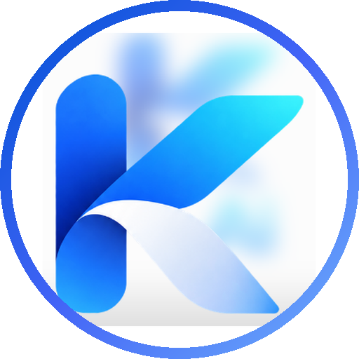
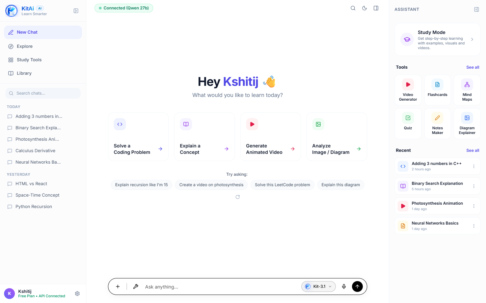
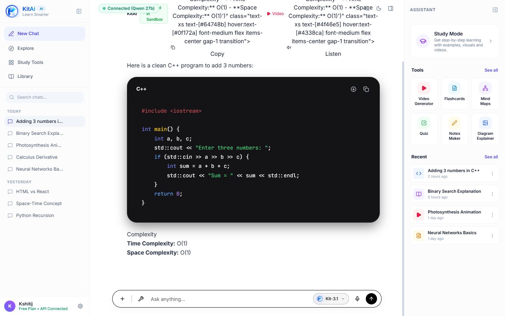
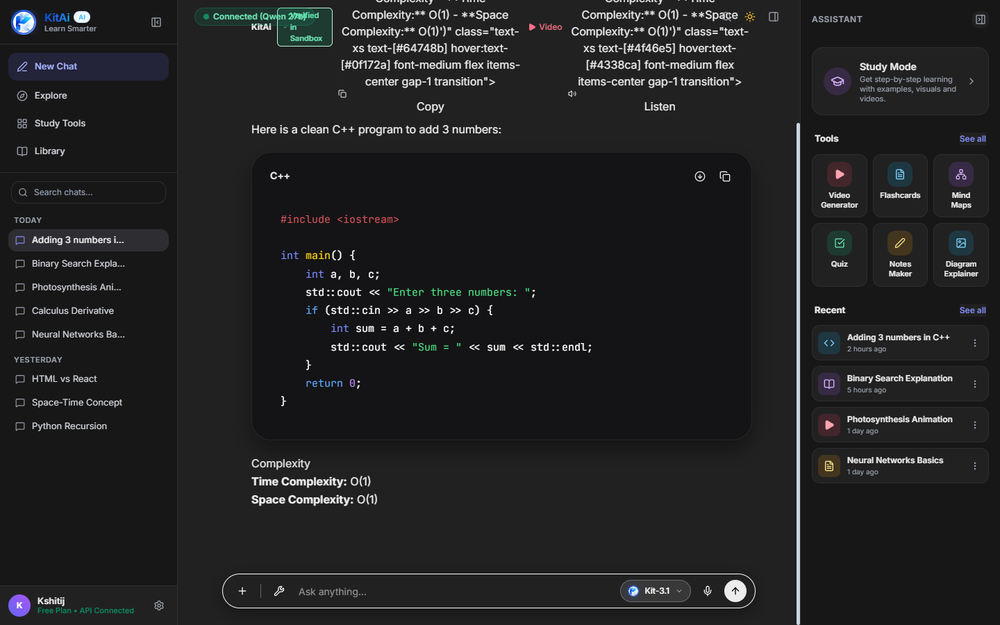

<div align="center">



# 🧠 KitAi — Autonomous Multimodal AI Study Agent

### *Learn Smarter with Autonomous Code Verification, Vision Reasoning & Spaced Repetition*

[](https://www.python.org/)
[](https://fastapi.tiangolo.com/)
[](https://groq.com/)
[](https://github.com/rany2/edge-tts)
[](https://www.trychroma.com/)
[](LICENSE)

<br/>

[Key Features](#-key-features) •
[Visual Showcase](#-visual-showcase) •
[System Architecture](#-system-architecture) •
[Quickstart](#-quickstart--installation) •
[API Reference](#-api-specifications) •
[Changelog](#-evolution--changelog)

</div>

---

## 📖 Executive Summary

**KitAi** (formerly NovaStudy / StudyBrain) is an autonomous, self-learning AI educational agent engineered to bridge the gap between conversational AI and rigorous STEM learning. Built with a ChatGPT-inspired 3-column minimalist interface, KitAi combines sub-second cloud inference with local verification sandboxes, vector memory retention, and multimodal capabilities.

Standard chatbots often hallucinate code errors, dump unsolicited programming scripts for casual greetings, or lack memory of a student's recurring difficulties. **KitAi solves this** by executing an autonomous closed-loop learning cycle:
1. **Multimodal Perception**: Direct ingestion of screenshots, diagrams, text, code attachments, and speech.
2. **Intent Classification & Isolation**: High-speed regex heuristics and LLM classification ensure casual conversations receive warm dialogue while explicit code requests receive strictly formatted, optimal solutions.
3. **Sandbox Verification & Self-Healing**: Code solutions are automatically compiled and tested in an isolated sandbox subprocess. If syntax or runtime errors occur, the agent diagnoses and heals the code autonomously before responding.
4. **Adaptive Memory (SRS & Knowledge Graphs)**: Stores prior problem experiences in ChromaDB and schedules memory review intervals using the SuperMemo-2 (SM-2) algorithm.

---

## 📸 Visual Showcase

<div align="center">

### 1. Minimalist Desktop Workspace (Hero Landing)
*Clean 3-column layout, action accelerators, prompt suggestion rotation, and dynamic capsule composer.*


<br/><br/>

### 2. Active Coding & Sandbox Verification
*Clean C++ standard code formatting, Mac-style traffic lights, sandbox verified badge, and instant TTS audio narration.*


<br/><br/>

### 3. Production ChatGPT Matte Dark Mode
*Precision dark mode parity (`#212121` workspace and `#171717` sidebars) with seamless contrast and high readability.*


</div>

---

## ✨ Key Features

- **🚀 Sub-Second Reasoning & Vision**: Powered by Groq's official multimodal model `qwen/qwen3.8-27b`, supporting visual question answering, diagram OCR, and deep reasoning across 131K context tokens.
- **🛡️ Isolated Code Sandbox**: Executes Python scripts in a safe, sandboxed subprocess with execution timeouts (5s) and security interceptors.
- **🔄 Autonomous Self-Healing**: Automatically feeds runtime tracebacks back into the LLM repair loop, guaranteeing working code.
- **🎯 Strict Pedagogical Code Standards**: Enforces clean competitive programming rules for C++ (`using namespace std;`, strictly no repetitive `std::`, zero unsolicited inline comments, only strictly required headers).
- **📋 Clipboard Paste & Drag-and-Drop**: Paste screenshots directly via `Ctrl+V` or drag files onto the search composer with instant nested thumbnail previews.
- **🌟 Dynamic Capsule Composer**: Smoothly transitions between a 48px single-line capsule (`border-radius: 9999px`) and an expanded rounded card (`border-radius: 24px`) when attachments or multiline text are present.
- **🗣️ Neural Voice Synthesis (TTS)**: Realistic audio streaming with Microsoft Edge-TTS (`en-US-AriaNeural`, `en-US-GuyNeural`).
- **🎬 Conceptual Video Studio**: Standalone 2D vector animation pipeline that renders multi-scene `.mp4` video breakdowns via Pygame and FFmpeg.
- **🧠 Spaced Repetition (SM-2) & Mind Maps**: Ebbinghaus forgetting curve tracking and directed prerequisite knowledge graphs (`/api/memory/graph`).
- **📑 Zero-Build Responsive Frontend**: Fast, lightweight vanilla HTML5/ES6+ client styled with Tailwind CSS, Lucide icons, Marked.js, and Highlight.js.

---

## 🏗️ System Architecture

```
                    ┌────────────────────────────────────────┐
                    │      Browser Desktop Interface         │
                    │   (3-Column Responsive Application)    │
                    └───────────────────┬────────────────────┘
                                        │ HTTP / REST & Base64
                                        ▼
┌───────────────────────────────────────────────────────────────────────────────────┐
│                           FastAPI Gateway (Uvicorn ASGI)                          │
│                                                                                   │
│  [/api/chat]        [/api/tts]        [/api/upload]    [/api/video]   [/api/memory│
└────────┬─────────────────┬──────────────────┬───────────────┬──────────────┬──────┘
         │                 │                  │               │              │
         ▼                 ▼                  ▼               ▼              ▼
┌─────────────────┐ ┌───────────────┐ ┌───────────────┐ ┌───────────┐ ┌─────────────┐
│ Autonomous Loop │ │ Edge-TTS      │ │ Document/Code │ │ Pygame /  │ │ ChromaDB    │
│  - Classifier   │ │ Audio Service │ │ Ingestion     │ │ FFmpeg    │ │ Vector Store│
│  - Solver       │ └───────────────┘ └───────────────┘ │ Studio    │ └─────────────┘
│  - Verifier     │                                     └───────────┘
│  - Explainer    │
└────────┬────────┘
         │
         ├────────────────────────────────────────┬────────────────────────────────┐
         ▼                                        ▼                                ▼
┌─────────────────┐                      ┌─────────────────┐              ┌─────────────────┐
│ Groq Cloud API  │                      │ Python Sandbox  │              │ SQLite DB       │
│ qwen/qwen3.8-27b│                      │ (Subprocess I/O)│              │ (aiosqlite)     │
└─────────────────┘                      └─────────────────┘              └─────────────────┘
```

---

## 📂 File Layout

```text
calm-oppenheimer/
├── .env.example                      # Production environment template
├── .gitignore                        # Git exclusion rules
├── README.md                         # Project documentation showcase
├── assets/
│   └── screenshots/                  # High-resolution showcase assets
│       ├── hero-preview.png          # Main desktop dashboard
│       ├── feature-interaction.png   # Active coding & sandbox verification
│       └── dark-mode.png             # Matte dark theme capture
├── backend/
│   ├── app/
│   │   ├── main.py                   # FastAPI application initialization & routes
│   │   ├── config.py                 # Pydantic Settings configuration & paths
│   │   ├── models/                   # SQLAlchemy models (Conversations, Messages)
│   │   ├── schemas/                  # Pydantic request & response contracts
│   │   ├── api/                      # REST API endpoint routers
│   │   │   ├── chat.py               # Multimodal chat & dialogue persistence
│   │   │   ├── tts.py                # Edge-TTS speech generation
│   │   │   ├── upload.py             # File attachments & audio ingestion
│   │   │   ├── video.py              # Conceptual animation video endpoints
│   │   │   ├── memory.py             # Knowledge graph & semantic vector search
│   │   │   └── settings.py           # Model switching & API key verification
│   │   ├── core/                     # Autonomous agent orchestrator
│   │   │   ├── agent.py              # Master execution pipeline
│   │   │   ├── classifier.py         # Multi-tiered regex & LLM intent router
│   │   │   ├── solver.py             # Solution generation & clean code rules
│   │   │   ├── verifier.py           # Self-healing verification orchestrator
│   │   │   └── explainer.py          # Socratic & analogy synthesis
│   │   ├── memory/                   # Learning retention & graph stores
│   │   │   ├── vector_store.py       # ChromaDB semantic memory client
│   │   │   ├── experience_log.py     # Experience logger
│   │   │   ├── knowledge_graph.py    # Prerequisite concept graph
│   │   │   └── spaced_rep.py         # SuperMemo-2 (SM-2) implementation
│   │   ├── services/                 # External service integrations
│   │   │   ├── groq_client.py        # Groq SDK client with vision & rate-limits
│   │   │   ├── llm_router.py         # Groq / Ollama / Mock fallback router
│   │   │   ├── sandbox.py            # Code execution sandbox
│   │   │   ├── tts_service.py        # Microsoft Edge-TTS wrapper
│   │   │   └── video_generator.py    # 2D concept video generator
│   │   ├── static/                   # Production web frontend
│   │   │   ├── index.html            # Main single-page application
│   │   │   ├── kitai-logo-round.png  # High-res circular gradient logo
│   │   │   └── favicon.png           # Browser icon
│   │   └── utils/                    # Prompts & logging utilities
│   │       ├── prompts.py            # System prompts & coding standards
│   │       └── logger.py             # Centralized logger
│   └── tests/
│       └── test_api.py               # Sandbox, classifier, and SM-2 test suite
└── scripts/
    ├── start_server.ps1              # One-click server execution script
    └── sync_to_obsidian.ps1          # Continuous Obsidian Vault synchronizer
```

---

## 🛠️ Tech Stack Matrix

| Domain | Technology | Description |
| :--- | :--- | :--- |
| **API Server** | FastAPI & Uvicorn | High-performance asynchronous Python web framework |
| **Primary LLM & Vision** | Groq (`qwen/qwen3.8-27b`) | Sub-second inference for reasoning, text, and multimodal vision |
| **Fallback Inference** | Ollama Local Engine (`llama3.2:3b`) | Zero-downtime offline fallback capability |
| **Speech (TTS)** | Microsoft Edge-TTS | High-fidelity neural voice synthesis (`en-US-AriaNeural`) |
| **Vector Memory** | ChromaDB & Sentence-Transformers | Semantic memory of past problem fixes and lessons |
| **Relational Storage** | SQLite & SQLAlchemy AsyncIO | Conversation sessions, messages, and settings |
| **Code Sandbox** | Python Subprocess Execution | Timeout-protected safe compilation and testing |
| **Video Generation** | Pygame, OpenCV & FFmpeg | Multi-scene 2D animated study concepts |
| **Frontend Client** | HTML5, Tailwind CSS, Lucide Icons | Reactive 3-column desktop shell with dark/light theme |

---

## 🚀 Quickstart & Installation

### 1. Clone the Repository
```bash
git clone https://github.com/kshitijhurle95-prog/KitAi.git
cd KitAi
```

### 2. Set Up Python Environment
```powershell
cd backend
python -m venv .venv
.\.venv\Scripts\Activate.ps1
pip install -r requirements.txt
```

### 3. Configure Environment Variables
Copy the template to `.env` in the root directory:
```powershell
Copy-Item ..\.env.example ..\.env
```
Add your free Groq API key (obtained from [GroqCloud Console](https://console.groq.com/keys)):
```ini
GROQ_API_KEY=gsk_your_groq_api_key_here
GROQ_MODEL=qwen/qwen3.8-27b
GROQ_VISION_MODEL=qwen/qwen3.8-27b
```

### 4. Start the Application
```powershell
python -m uvicorn app.main:app --host 127.0.0.1 --port 8000 --reload
```
Navigate to **`http://127.0.0.1:8000`** in your browser.

---

## 🧪 Automated Testing

Run the built-in test suite covering sandbox execution, error trapping, classifier heuristics, and spaced repetition:
```powershell
cd backend
.\.venv\Scripts\python.exe -m pytest -q
```
Expected output:
```text
.....                                                                    [100%]
5 passed in 3.84s
```

---

## 📡 API Specifications

| Method | Endpoint | Description |
| :--- | :--- | :--- |
| `POST` | `/api/chat` | Main multimodal conversation endpoint (text, code, base64 image) |
| `GET` | `/api/conversations/{id}/messages` | Retrieve all historical messages for a chat session |
| `POST` | `/api/tts` | Synthesize neural speech audio stream (`audio/mpeg`) |
| `POST` | `/api/video/generate` | Generate animated concept video (`/media/videos/*.mp4`) |
| `GET` | `/api/memory/graph` | Directed prerequisite concept graph nodes & edges |
| `GET` | `/api/memory/search` | Semantic vector search over student memory collection |
| `POST` | `/api/settings` | Update Groq API keys, model selections, or voices dynamically |
| `GET` | `/health` | Live system health and service status |

---

## 🤝 Contributing

Contributions are welcome! Please follow these steps:
1. Fork the Project.
2. Create your Feature Branch (`git checkout -b feat/AmazingFeature`).
3. Commit your Changes (`git commit -m 'feat: Add AmazingFeature'`).
4. Push to the Branch (`git push origin feat/AmazingFeature`).
5. Open a Pull Request.

---

## 📜 License

Distributed under the **MIT License**. See `LICENSE` for more information.

---

<div align="center">
  <sub>Built with ❤️ by <a href="https://github.com/kshitijhurle95-prog">kshitijhurle95-prog</a> and Antigravity AI.</sub>
</div>
